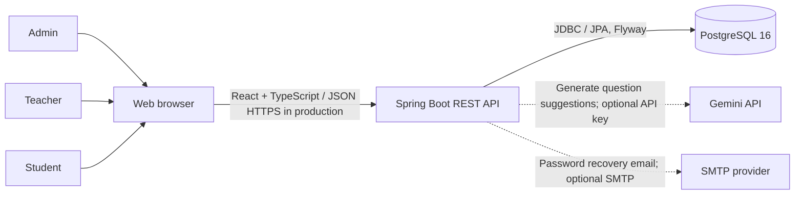
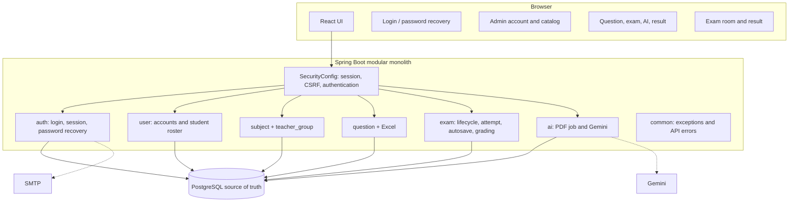
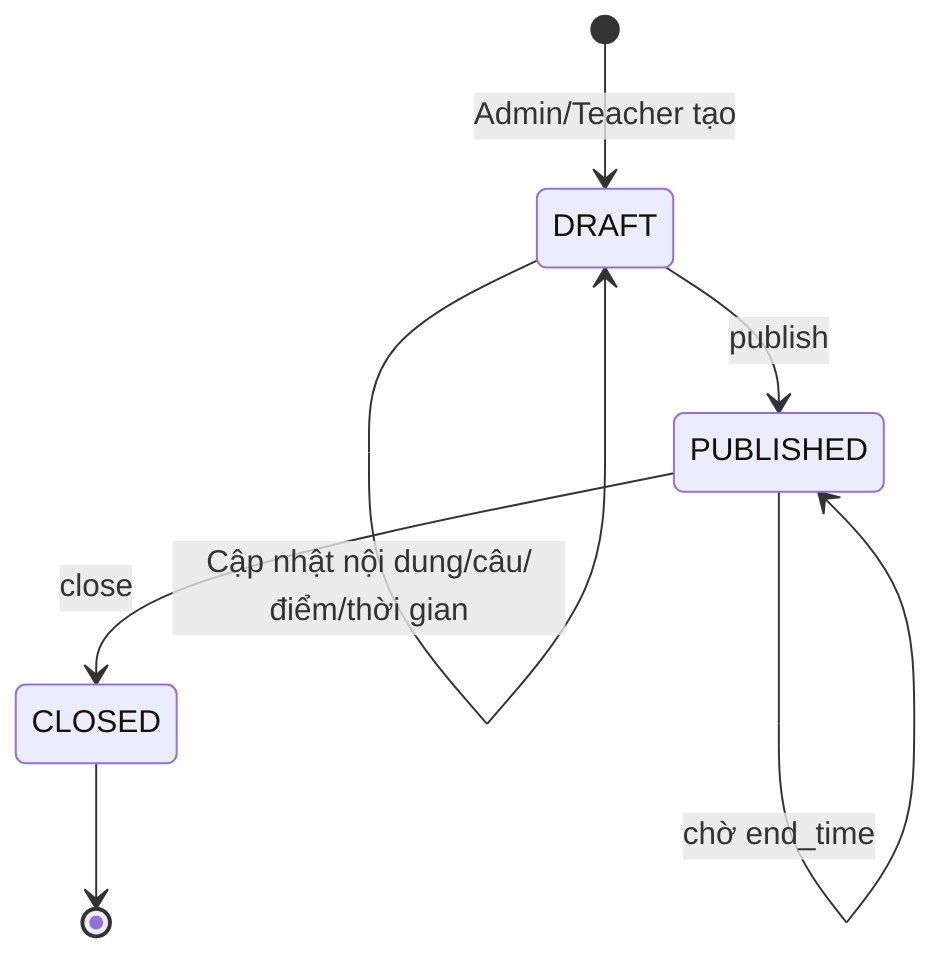
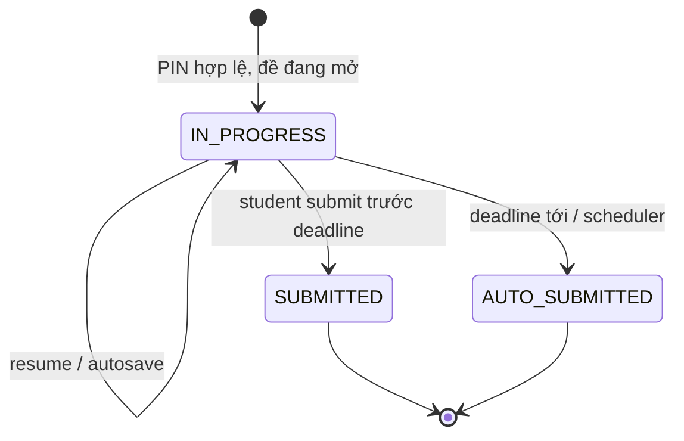
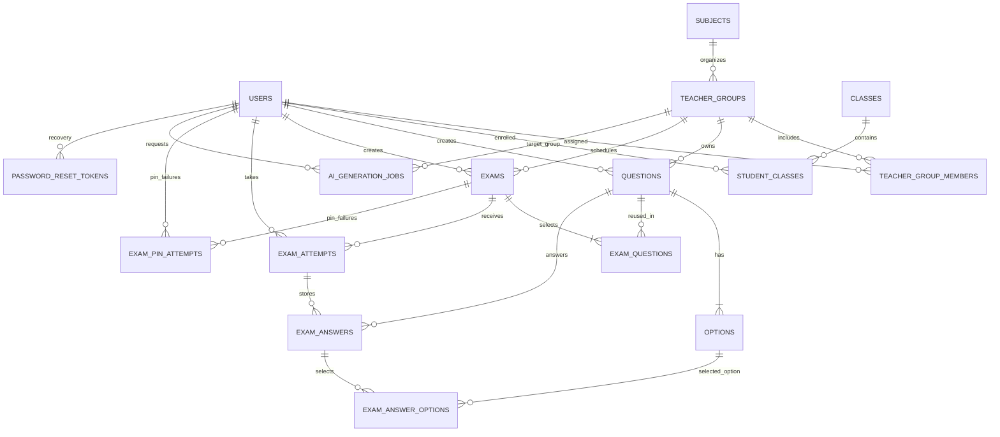

# Kiến trúc, luồng nghiệp vụ và mô hình dữ liệu

**Nguồn schema:** Flyway `backend/src/main/resources/db/migration/V1`–`V8`; **backend path:** `/api` và `/api/v1/auth`; **auth:** session cookie + CSRF. Sơ đồ thể hiện implementation hiện có, Redis là ngoài phạm vi.

## 1. System context



Vận hành local dùng Vite proxy `/api` → backend `localhost:8080`; backend local kết nối PostgreSQL qua port cấu hình. Trên production phải dùng HTTPS, cấu hình origin/cookie phù hợp và không để secret ở frontend.

## 2. Container và module



Một backend deployable, chia package theo domain; controller xử lý HTTP, service thực thi quy tắc, repository/JDBC/JPA truy cập dữ liệu. Một số module hiện dùng `JdbcTemplate`, không nên mô tả toàn bộ persistence là JPA.

## 3. Luồng vòng đời kỳ thi

```mermaid
sequenceDiagram
  actor A as Admin
  actor T as Teacher
  actor S as Student
  participant FE as React
  participant API as Spring Boot
  participant DB as PostgreSQL
  A->>FE: Tạo tài khoản, môn, nhóm, phân công teacher
  FE->>API: POST/PATCH users, subjects, teacher-groups
  API->>DB: Lưu users/catalog/membership
  T->>FE: Soạn câu hỏi / import Excel
  FE->>API: CRUD questions hoặc multipart Excel
  API->>DB: Validate quyền group; ghi questions/options
  T->>FE: Tạo DRAFT, chọn câu/điểm và publish
  FE->>API: POST /api/exams, POST /{id}/publish
  API->>DB: Ghi exams + exam_questions; khóa nội dung đã publish
  S->>FE: Chọn kỳ thi, nhập PIN
  FE->>API: POST /api/exams/{id}/attempts
  API->>DB: Kiểm tra role/time/PIN; tạo hoặc resume unique attempt
  API-->>FE: Đề dành cho student (không PIN/answer key)
  loop Mỗi thay đổi đáp án
    S->>FE: Chọn đáp án/nhập text
    FE->>FE: Tạm giữ đáp án pending trong localStorage
    FE->>API: PUT /api/attempts/{id}/answers/{questionId}
    API->>DB: Upsert exam_answers/options
    API-->>FE: 204; xóa pending đã sync
  end
  S->>FE: Nộp bài hoặc hết giờ
  FE->>API: POST /api/attempts/{id}/submit
  API->>DB: Khóa attempt, chấm, chuyển trạng thái một lần
  API-->>FE: Kết quả
  T->>FE: Xem kết quả theo kỳ thi
  FE->>API: GET /api/exams/{id}/results
  API->>DB: Kiểm tra teacher group và đọc result
```

## 4. State machine

### Exam



Service chỉ cho publish DRAFT, close PUBLISHED, và update DRAFT. `end_time` cũng làm đề không còn mở cho sinh viên dù status vẫn PUBLISHED.

### Attempt



Unique `(exam_id, student_id)` bảo đảm mỗi người một lượt; answer unique `(attempt_id, question_id)` hỗ trợ upsert. Submit/status là nguồn quyết định idempotency; không lấy đồng hồ browser làm chuẩn.

## 5. ERD đang triển khai



### Bảng trọng yếu

| Bảng | Vai trò / quy tắc |
|---|---|
| `users` | Identity, role, `enabled`, profile; `password_hash` chứa BCrypt, không chứa password plaintext; một admin bằng partial unique index. |
| `subjects`, `teacher_groups`, `teacher_group_members` | Môn → nhóm; bảng membership kiểm soát quyền teacher. |
| `classes`, `student_classes` | Danh mục lớp và quan hệ nhiều-nhiều sinh viên/lớp. |
| `questions`, `options` | Ngân hàng độc lập với kỳ thi; option có `is_correct`, thứ tự. API student không trả cờ đúng. |
| `exams`, `exam_questions` | Metadata đề và câu dùng lại qua bảng nối; lưu thứ tự và điểm. |
| `exam_attempts` | Một lần làm cho user/exam; lưu deadline, status, submitted time, total score. |
| `exam_answers`, `exam_answer_options` | Đáp án text và lựa chọn; unique answer per question/attempt. |
| `exam_pin_attempts` | Đếm PIN sai và mốc khóa tạm theo student/exam. |
| `ai_generation_jobs` | Job nền, teacher, group, tên/path PDF, trạng thái, JSON kết quả/error. |
| `password_reset_tokens` | `user_id`, token digest, created/expiry/used; token nguyên không lưu DB. |

### Quy tắc xóa và lưu vết

Foreign key bảo vệ liên kết; câu hỏi được đề đã công bố tham chiếu bằng `ON DELETE RESTRICT`; options xóa theo câu. Attempt/answers bền trong PostgreSQL. Migrations là nguồn schema thực tế; [`database/full-schema.sql`](../database/full-schema.sql) là script legacy có `DROP TABLE`, không dùng để nâng cấp hoặc chạy trên DB cần giữ dữ liệu.

## 6. Xử lý lỗi/mất mạng và giới hạn

- Backend/PostgreSQL là chuẩn. Browser lưu pending answer trong `localStorage` và retry khi event `online`; resume đọc attempt từ server.
- Nếu mất mạng đúng lúc submit hoặc pending chưa kịp sync, người dùng có thể cần retry; đây không phải offline exam.
- Scheduler chạy mỗi 5 giây, lấy tối đa 100 attempt quá hạn mỗi lượt. Lưu lượng cao cần quan sát backlog và tuning.
- `saveAnswer` từ chối sau deadline; submit chấm phía server. Giao diện cũng có timer nhưng không được tin như đồng hồ authoritative.
- AI PDF hiện trích xuất text; scanned PDF/OCR không hỗ trợ; job thất bại nếu thiếu key/model/API.

## 7. Migration

| Version | Nội dung |
|---|---|
| V1 | Users, subjects, teacher groups và membership. |
| V2 | Question bank/options, timestamp môn học. |
| V3 | Classes, student-class, exams, exam questions, attempts/answers, AI jobs, difficulty/explanation. |
| V4 | Seed demo data. |
| V5 | Cập nhật BCrypt demo hashes; unique admin. |
| V6 | Theo dõi/khóa nhập PIN sai. |
| V7 | Liên kết AI job với group, original filename. |
| V8 | Password recovery token table/index. |

Flyway chạy khi backend start. Với DB đã được tạo thủ công/đã có schema khác, backup và đối chiếu `flyway_schema_history` trước khi khởi động; không xóa volume để “sửa” migration.
