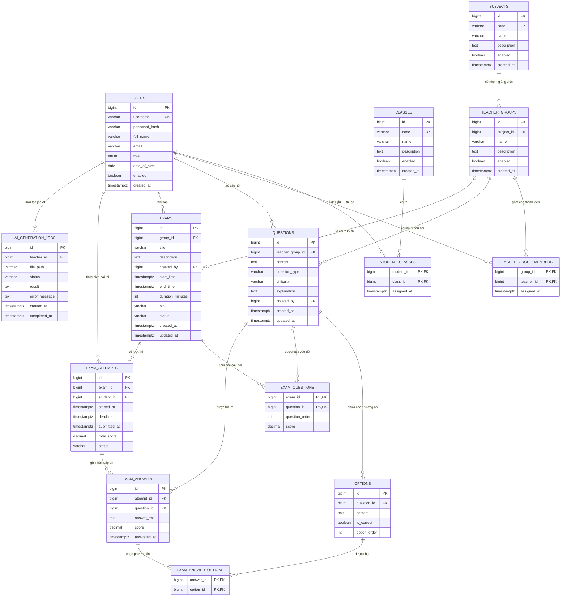

# Tài Liệu Cơ Sở Dữ Liệu (Database Documentation)

Hệ thống thi trực tuyến sử dụng **PostgreSQL 16** làm nguồn lưu trữ chân lý (Source of Truth) cho toàn bộ tài khoản, môn học, ngân hàng câu hỏi, đề thi, lượt làm bài và kết quả chấm điểm.

---

## 1. Sơ Đồ Thực Thể - Mối Quan Hệ (Entity-Relationship Diagram)



---

## 2. Danh Mục Các Bảng & Ràng Buộc Nghiệp Vụ

### 2.1. Phân hệ Người dùng & Lớp học
| Bảng | Ý nghĩa | Ràng buộc chính |
| :--- | :--- | :--- |
| `users` | Tài khoản hệ thống (Admin, Giảng viên, Sinh viên) | `UNIQUE(username)`, `role IN ('ADMIN', 'TEACHER', 'STUDENT')` |
| `classes` | Danh mục lớp sinh viên (THH1525, KTTC125,...) | `UNIQUE(code)` |
| `student_classes` | Quan hệ nhiều-nhiều: Sinh viên thuộc một hoặc nhiều lớp | `PRIMARY KEY(student_id, class_id)` |

### 2.2. Phân hệ Môn học & Nhóm Giảng viên
| Bảng | Ý nghĩa | Ràng buộc chính |
| :--- | :--- | :--- |
| `subjects` | Danh mục môn học | `UNIQUE(code)` |
| `teacher_groups` | Nhóm giảng viên phụ trách môn học | `UNIQUE(subject_id, name)` |
| `teacher_group_members` | Phân quyền giảng viên vào nhóm môn học | `PRIMARY KEY(group_id, teacher_id)` |

### 2.3. Phân hệ Ngân hàng Câu hỏi
| Bảng | Ý nghĩa | Ràng buộc chính |
| :--- | :--- | :--- |
| `questions` | Ngân hàng câu hỏi độc lập của nhóm môn | `question_type IN ('SINGLE_CHOICE', 'MULTIPLE_CHOICE', 'SHORT_ANSWER')` |
| `options` | Các lựa chọn của câu hỏi | `UNIQUE(question_id, option_order)` |

> [!NOTE]
> Với câu hỏi ngắn (`SHORT_ANSWER`), mỗi phương án chấp nhận được lưu là 1 dòng trong bảng `options` với `is_correct = TRUE`. Khi sinh viên nộp bài, hệ thống chuẩn hóa chuỗi (trim, lowercase) và đối sánh tự động.

### 2.4. Phân hệ Kỳ thi & Khóa đề (Exam Management)
| Bảng | Ý nghĩa | Ràng buộc chính |
| :--- | :--- | :--- |
| `exams` | Thông tin kỳ thi, thời lượng, mã PIN | `status IN ('DRAFT', 'PUBLISHED', 'CLOSED')`, `end_time > start_time` |
| `exam_questions` | Danh sách câu hỏi và điểm số từng câu | `PRIMARY KEY(exam_id, question_id)`, `UNIQUE(exam_id, question_order)` |

> [!IMPORTANT]
> **Quy tắc khóa đề thi**: Sau khi kỳ thi chuyển sang trạng thái `PUBLISHED` hoặc `CLOSED`, toàn bộ danh sách câu hỏi trong `exam_questions` và nội dung câu hỏi trong `questions` bị khóa không cho sửa hoặc xóa để bảo toàn tính toàn vẹn của kết quả bài thi.

### 2.5. Phân hệ Làm bài & Chịu lỗi (Exam Attempt & Autosave)
| Bảng | Ý nghĩa | Ràng buộc chính |
| :--- | :--- | :--- |
| `exam_attempts` | Lượt làm bài thi của sinh viên | **`UNIQUE(exam_id, student_id)`**: Mỗi sinh viên chỉ có 1 attempt duy nhất cho mỗi kỳ thi. Nền tảng cho start/resume idempotent. |
| `exam_answers` | Đáp án đã lưu của sinh viên | **`UNIQUE(attempt_id, question_id)`**: Nền tảng cho tính năng Upsert Autosave khi sinh viên chọn câu trả lời. |
| `exam_answer_options` | Tùy chọn đã tích trong câu trắc nghiệm | `PRIMARY KEY(answer_id, option_id)` |

### 2.6. Phân hệ AI Sinh câu hỏi
| Bảng | Ý nghĩa | Ràng buộc chính |
| :--- | :--- | :--- |
| `ai_generation_jobs` | Theo dõi tiến trình trích xuất PDF và gọi Gemini API | `status IN ('PENDING', 'PROCESSING', 'COMPLETED', 'FAILED')` |

---

## 3. Cấu Trúc Tệp Triển Khai Trong Dự Án

- **Tệp DDL độc lập (Toàn bộ Schema)**: [`docs/database/full-schema.sql`](file:///d:/online-exam-system/docs/database/full-schema.sql)
- **Tệp Dữ liệu mẫu (Seed Data)**: [`docs/database/seed-data.sql`](file:///d:/online-exam-system/docs/database/seed-data.sql)
- **Tệp Migration Flyway Spring Boot**:
  - `V1__init_schema.sql`: Bảng người dùng, môn học, nhóm giảng viên ban đầu.
  - `V2__question_bank_and_subject_timestamp.sql`: Câu hỏi và phương án ban đầu.
  - `V3__complete_exam_and_attempt_schema.sql`: Toàn bộ bảng Kỳ thi, Bài thi, Lớp học, Trả lời, AI Jobs.
  - `V4__seed_initial_data.sql`: Dữ liệu mẫu khởi tạo tự động.

---

## 4. Hướng Dẫn Chạy & Khởi Tạo Database

### Cách 1: Khởi động tự động cùng Docker Compose & Flyway (Khuyên dùng)
1. Bật Docker Desktop.
2. Khởi động PostgreSQL:
   ```bash
   docker-compose up -d
   ```
3. Khi Spring Boot khởi động, Flyway sẽ tự động quét và chạy các tệp `V1` -> `V4` trong `backend/src/main/resources/db/migration/`.

### Cách 2: Chạy trực tiếp qua psql hoặc DBeaver / pgAdmin
Kết nối tới PostgreSQL (Cổng `5433`, database `online_exam`):
```bash
psql -h localhost -p 5433 -U exam_user -d online_exam -f docs/database/full-schema.sql
psql -h localhost -p 5433 -U exam_user -d online_exam -f docs/database/seed-data.sql
```
Mật khẩu mặc định: `17122005` (hoặc xem trong tệp `.env`).
