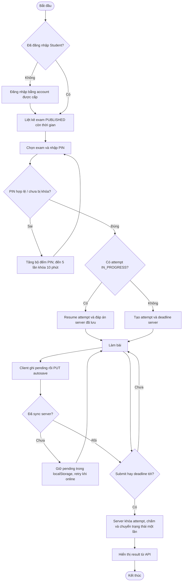

# Activity diagram — luồng làm bài

Deadline server bằng `min(started_at + duration, exam.end_time)`. Local timer chỉ phục vụ trải nghiệm; PostgreSQL/backend mới có quyền quyết định. Nếu browser chưa kịp đồng bộ, localStorage không đảm bảo offline hoàn chỉnh.
