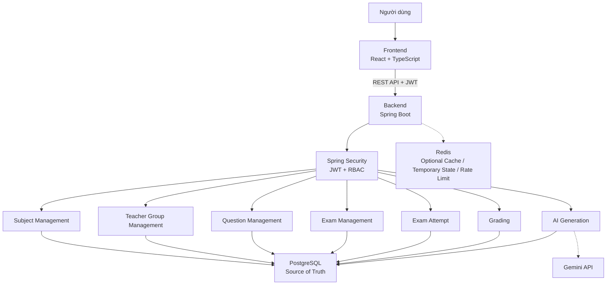
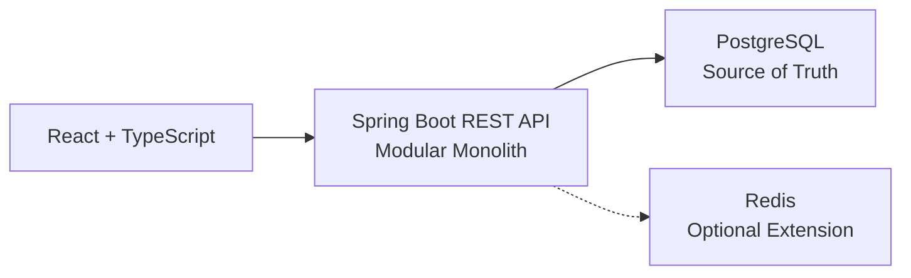
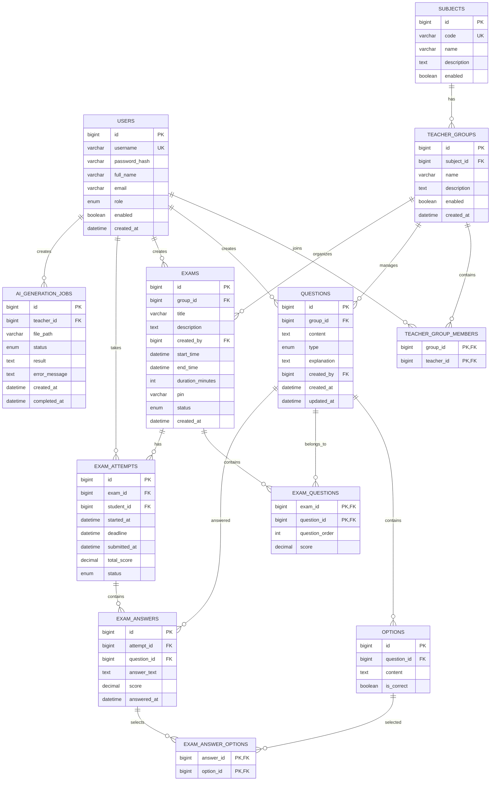
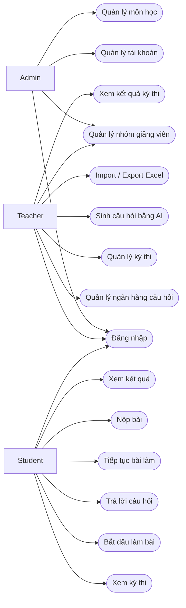
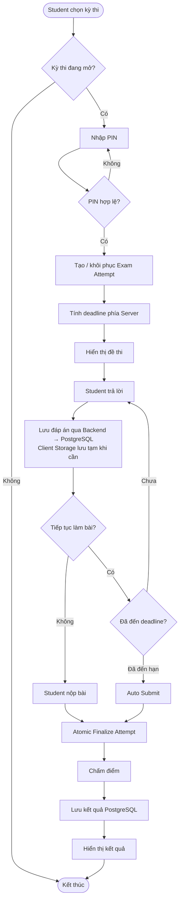
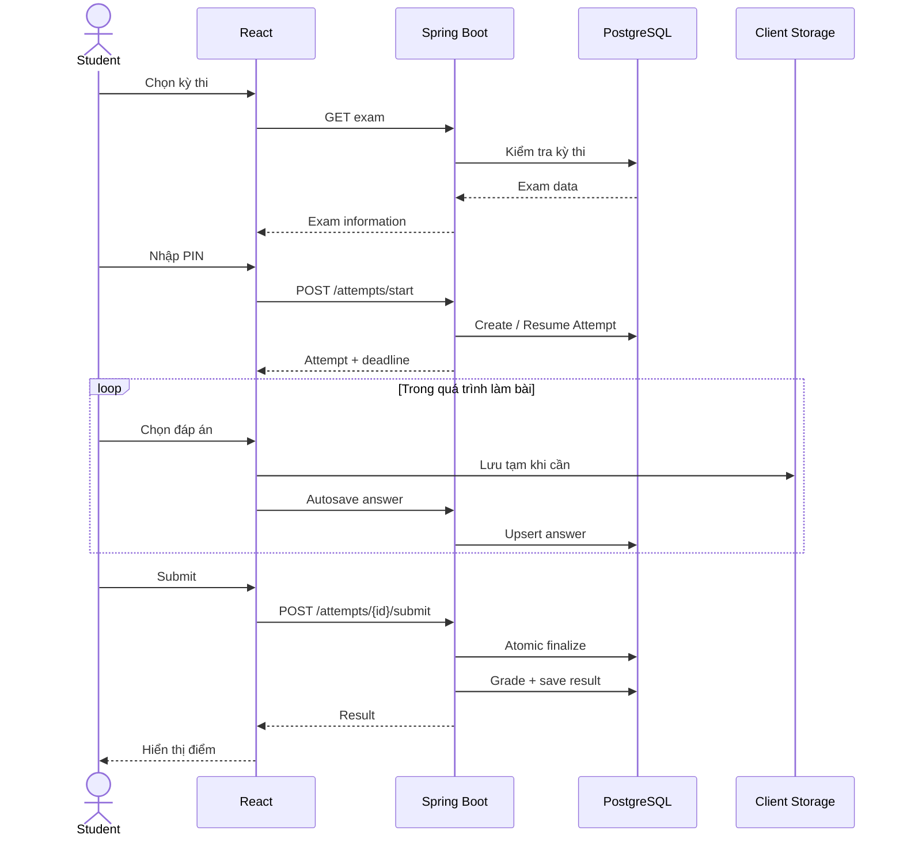
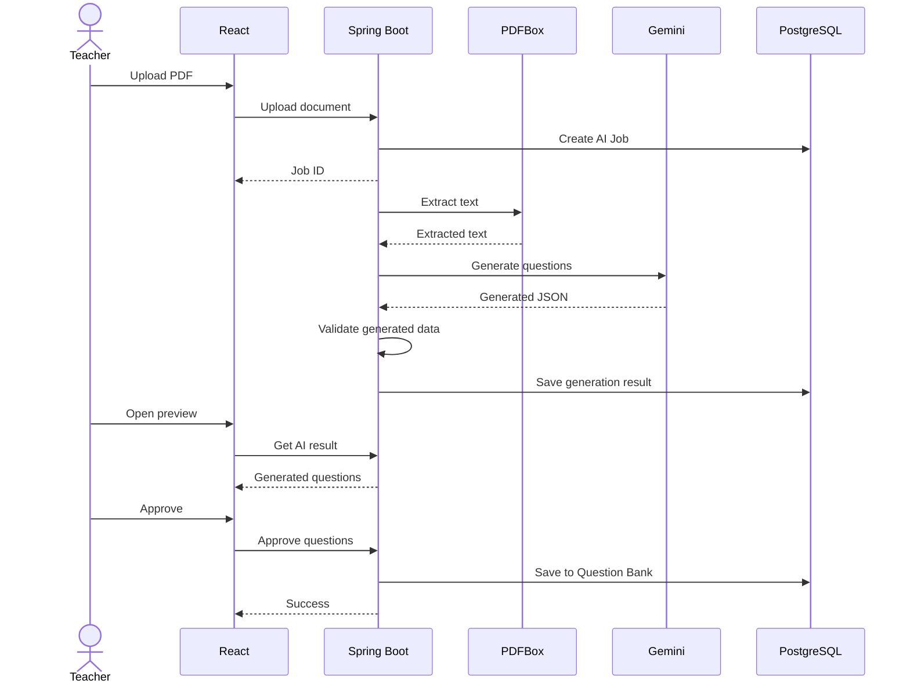
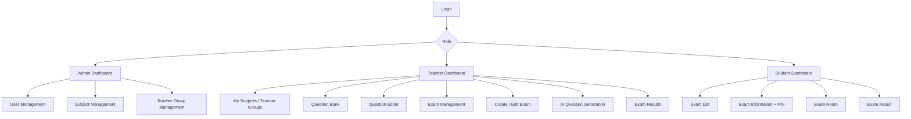
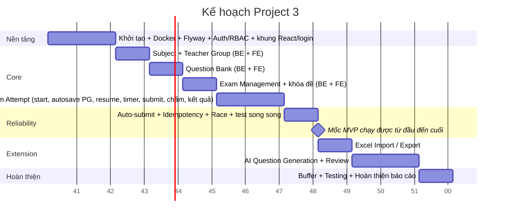

# 1. Tổng quan đề tài
## 1.1. Tên đề tài
XÂY DỰNG HỆ THỐNG THI TRỰC TUYẾN HỖ TRỢ QUẢN LÝ NGÂN HÀNG CÂU HỎI, TỔ CHỨC KỲ THI VÀ TỰ ĐỘNG CHẤM ĐIỂM

## 1.2. Mô tả nghiệp vụ
- Đối tượng sử dụng:
    + ADMIN: tài khoản khởi tạo sẵn, tạo và quản lý tài khoản giảng viên/sinh viên
    + TEACHER: tham gia một hoặc nhiều nhóm giảng viên phụ trách môn học; quản lý ngân hàng câu hỏi, lập kỳ thi, cấu hình thời gian thi, xem kết quả và sử dụng module AI.
    + STUDENT: vào thi, làm bài, xem điểm

- Ngân hàng câu hỏi và đề thi:
    + Ba loại câu hỏi được sử dụng trong phiên bản triển khai: Single Choice, Multiple Choice và Short Answer.
    + Ngân hàng câu hỏi độc lập với kỳ thi: một câu hỏi có thể được sử dụng trong nhiều kỳ thi thông qua bảng trung gian exam_questions
    + Với Multiple Choice, Project 3 áp dụng chấm điểm all-or-nothing: chọn đúng toàn bộ đáp án đúng mới được điểm.
    + Short Answer: mỗi đáp án chấp nhận được lưu thành một dòng trong bảng OPTIONS với is_correct = true. Câu trả lời của sinh viên được chuẩn hóa (trim, lowercase, chuẩn hóa khoảng trắng) rồi so khớp với từng đáp án đã được chuẩn hóa tương tự; có thể hỗ trợ tương đương số đơn giản như 3 và 3.0.
    + Import câu hỏi hàng loạt từ Excel:
    + Export Excel ở mức cơ bản.

- Mô hình: Mỗi kỳ thi có một đề cố định, nội dung giống nhau cho mọi sinh viên. Một kỳ thi chứa:
    + môn học/nhóm giảng viên phụ trách;
    + danh sách câu hỏi;
    + thứ tự câu hỏi;
    + điểm từng câu;
    + thời gian bắt đầu/kết thúc;
    + thời lượng;
    + mã PIN;
    + trạng thái DRAFT/PUBLISHED/CLOSED. 

- Quyền tham gia thi: quyền vào thi được kiểm soát bằng tài khoản sinh viên, thời gian thi và mã PIN.
    + Sinh viên chỉ nhìn thấy các kỳ thi có trạng thái PUBLISHED.
    + API trả đề thi cho sinh viên dùng DTO riêng, tuyệt đối không trả trường is_correct hay đáp án.
    + Giới hạn số lần nhập sai PIN (ví dụ 5 lần / sinh viên / kỳ thi, khóa tạm vài phút). Dùng bộ đếm trong DB hoặc bộ nhớ ứng dụng, không cần Redis.
    + Mọi API câu hỏi và kỳ thi của Teacher phải kiểm tra Teacher thuộc group tương ứng (teacher_group_members).
    + Mỗi sinh viên chỉ có một attempt cho mỗi kỳ thi.

- Quy tắc khóa đề: sau khi đề thi được công bố, không cho thay đổi danh sách câu hỏi, điểm số, thời gian thi. Câu hỏi và đáp án thuộc đề đã công bố không được chỉnh sửa hoặc xóa; điều này cũng bảo toàn kết quả của các bài đã thi. Mọi thay đổi chỉ được thực hiện ở trạng thái DRAFT.

- Luồng làm bài và chịu lỗi:
    + Server là nguồn xác định thời gian: deadline = min(started_at + duration, exam.end_time), lưu trong PostgreSQL.
    + PostgreSQL là Source of Truth cho attempt, answers và kết quả.
    + Autosave bài làm trước hết được thực hiện qua Backend → PostgreSQL. Redis chỉ là thành phần mở rộng/tối ưu, không phải nguồn dữ liệu chính.
    + Trình duyệt có thể lưu tạm các đáp án chưa đồng bộ để giảm rủi ro mất dữ liệu khi mất mạng ngắn; đây không phải chế độ offline hoàn chỉnh.
    + Sinh viên có thể resume attempt IN_PROGRESS sau F5/đóng tab hoặc khôi phục kết nối.
    + Tự động nộp khi hết giờ: lazy khi có request kết hợp scheduler quét định kỳ.
    + Submit và auto-submit phải idempotent; xử lý tranh chấp bằng chuyển trạng thái nguyên tử IN_PROGRESS → SUBMITTED/AUTO_SUBMITTED.
    + Chấm điểm được thực hiện phía server.

# 2. Thiết kế kiến trúc + ERD
## 2.1. Kiến trúc hệ thống

### Nguyên tắc kiến trúc

## 2.2. ERD

### Ràng buộc bổ sung
- UNIQUE (exam_id, student_id) trên EXAM_ATTEMPTS: mỗi sinh viên một attempt cho mỗi kỳ thi, nền tảng cho start/resume idempotent.
- UNIQUE (attempt_id, question_id) trên EXAM_ANSWERS: nền tảng cho upsert autosave.
- Short Answer: đáp án chấp nhận được lưu trong OPTIONS với is_correct = true (mỗi dòng một đáp án).
- Tầng service kiểm tra: câu hỏi thêm vào kỳ thi phải cùng group_id với kỳ thi.
- Tầng service kiểm tra: câu hỏi đang thuộc kỳ thi PUBLISHED/CLOSED không được sửa hoặc xóa.
- Giá trị enum:
  - users.role: ADMIN, TEACHER, STUDENT
  - questions.type: SINGLE_CHOICE, MULTIPLE_CHOICE, SHORT_ANSWER
  - exams.status: DRAFT, PUBLISHED, CLOSED
  - exam_attempts.status: IN_PROGRESS, SUBMITTED, AUTO_SUBMITTED
  - ai_generation_jobs.status: PENDING, PROCESSING, COMPLETED, FAILED

# 3. Thiết kế luồng
## 3.1. Use Case Diagram

## 3.2. Activity Diagram - luồng làm bài

## 3.3. Sequence Diagram - làm bài

## 3.4. Sequence Diagram - AI sinh câu hỏi

# 4. Thiết kế giao diện

# 5. Bài toán + Công nghệ + Kế hoạch
## 5.1. Bảng giải pháp
| Bài toán | Phương pháp | Công cụ |
| :--- | :--- | :--- |
| Kiểm soát thời gian | Server-side timer, deadline lưu DB | Spring Boot + PostgreSQL |
| Mất bài khi F5 | Backend autosave + Resume | Spring Boot + PostgreSQL |
| Mất mạng ngắn | Client-side storage + sync | React |
| Submit trùng | Idempotent operation | Transaction |
| Race Submit/Auto-submit | Atomic state transition | PostgreSQL |
| Hết giờ | Lazy auto-submit + scheduler | Spring Scheduler |
| LLM chậm | Async processing | Spring Async |
| LLM sinh sai | Validation + human review | Gemini + Backend |
| Lộ đáp án cho sinh viên | DTO riêng cho Student, không trả is_correct | Spring Boot |
| Dò PIN (brute-force) | Giới hạn số lần nhập sai PIN | Spring Boot (bộ đếm DB / bộ nhớ) |

## 5.2. Tech stack
| Layer | Technology |
| :--- | :--- |
| Frontend | React + TypeScript |
| Backend | Spring Boot 4.1.1 / Java 17 |
| Database | PostgreSQL |
| Temporary storage | Redis (tùy chọn, chỉ làm sau mốc MVP nếu còn thời gian) |
| Authentication | Spring Security + JWT |
| AI | Gemini API |
| PDF | PDFBox |
| Excel | Apache POI |
| Deployment | Docker Compose |

## 5.3. Kế hoạch 12 tuần

**Lưu ý:** Các chức năng mở rộng dưới đây sẽ được xem xét bổ sung tùy theo tiến độ thực hiện:
- Excel import/export
- Redis
- Docker
- AI hỗ trợ sinh câu hỏi từ PDF

| Tuần    | Nội dung                                                        | Mức độ    |
| ------- | --------------------------------------------------------------- | --------- |
| **W1**  | Project setup + Git + Docker + PostgreSQL + Spring Boot + React | Bắt buộc  |
| **W2**  | Flyway + User + Login + JWT + RBAC                              | Bắt buộc  |
| **W3**  | Subject + Teacher Group                                         | Bắt buộc  |
| **W4**  | Question Bank + Question CRUD                                   | Bắt buộc  |
| **W5**  | Exam Management + publish/lock                                  | Bắt buộc  |
| **W6**  | Student Exam + Start Attempt + PIN                              | Bắt buộc  |
| **W7**  | Answer + Autosave + Resume + Timer                              | Bắt buộc  |
| **W8**  | Submit + Auto-submit + Grading + Result                         | **MVP**   |
| **W9**  | Fix bug + integration test + hoàn thiện UI                      | Bắt buộc  |
| **W10** | Excel Import/Export                                             | Extension |
| **W11** | AI PDF → Gemini → Review                                        | Extension |
| **W12** | Testing + Redis nếu còn thời gian + báo cáo                     | Buffer    |
