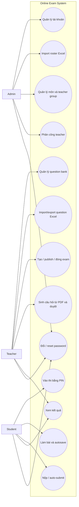

# Use-case diagram — as-built

Các tác nhân và capability dưới đây phản ánh API hiện tại. Kiểm tra quyền backend vẫn là bắt buộc; sơ đồ này không đại diện cho authorization implementation.

**Chưa bao gồm:** mô hình invitation/self-registration, quản lý học kỳ/ca thi đầy đủ, audit/anti-cheat và báo cáo nâng cao.
